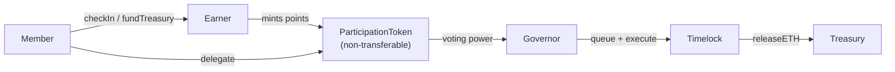

# Participation DAO – Voting Power Earned, Not Bought

A DAO where voting power is **earned through participation** instead of bought. Members check in
once per day or fund the treasury, receive non-transferable points, delegate them to activate their
votes, and govern a treasury through an OpenZeppelin Governor + TimelockController.

**Highlights**

- Full proposal lifecycle executed on Sepolia: earn → delegate → propose → vote → queue → execute, with a real ETH grant paid out by the treasury
- Mechanism design against whales: per-user and global caps per epoch, so money helps but never buys unlimited influence
- The DAO fully controls itself after deployment: the timelock owns the treasury and all admin roles, the deployer keeps only an emergency pause
- 21 Foundry tests, including the full Governor + Timelock workflow, negative paths and a fuzz test
- Debugged a deployment that broke after a hard fork repriced contract creation (see [Problems & Solutions](#problems--solutions))

**Stack:** Solidity · Foundry · OpenZeppelin Governor, TimelockController, ERC20Votes · Sepolia

> Built as part of Metana's Full Stack Web3 Bootcamp.

---

## How it works



| Contract | Purpose |
|---|---|
| `ParticipationToken.sol` | `ERC20` + `ERC20Permit` + `ERC20Votes` + `AccessControlDefaultAdminRules`. Non-transferable (only mint/burn pass `_update`), minting restricted to `MINTER_ROLE`, clock switched to timestamps (ERC-6372). |
| `Earner.sol` | The two earning actions, per-user and global caps per epoch, check-in bitmap, pause, `PointsEarned` event and constant-time views (`currentEpoch`, `claimedCheckIn`, `remainingUserCap`, `remainingGlobalCap`). |
| `ParticipationGovernor.sol` | OpenZeppelin Governor composed of `GovernorSettings`, `GovernorCountingSimple`, `GovernorVotes`, `GovernorVotesQuorumFraction` and `GovernorTimelockControl`. All parameters come from the constructor. |
| `Treasury.sol` | Holds ETH and ERC20. Owned by the timelock (`Ownable2Step`), payouts via `releaseETH` / `releaseERC20`, protected by `ReentrancyGuardTransient`, pausable. |
| `TimelockController` | OpenZeppelin, unchanged. Deployed and wired in `script/Deploy.s.sol`. |

---

## Mechanism Design: Earning Rules

| Rule | Value |
|---|---|
| Epoch length | 1 day (epoch 0 starts at deployment) |
| Check-in | 10 points, once per epoch |
| Funding the treasury | 100 points per 1 ETH (0.1 ETH = 10 points) |
| Per-user cap | 50 points per epoch, both actions combined |
| Global cap | 1,000 points per epoch for all users together |
| Exceeding a cap | the whole transaction reverts (`UserCapExceeded` / `GlobalCapExceeded`), funded ETH stays with the user |

**Why these numbers.** One day of maximum funding (0.5 ETH) gives five times the points of a
check-in, but never more than 50 points per day. Money helps a bit, it doesn't buy unlimited
influence. Coming from tokenomics, I wanted the cap to be the main defence against whales, not an
afterthought.

**Revert instead of partial minting.** When a cap is hit, the transaction reverts. Partial minting
would accept the ETH but silently give fewer points. A revert is less convenient, but nobody pays
for points they don't get.

**Storage.** Points are tracked in two counters (`_userPointsInEpoch`, `_totalPointsInEpoch`) and
check-ins in a per-user `BitMap` (bit index = epoch, 256 epochs per storage slot). A new epoch
automatically starts from zero, nothing has to be reset.

---

## Delegation

Holding points is **not** the same as having votes:

- After earning, a user has a **balance** but **0 votes**.
- `delegate(self)` turns the balance into votes. `delegate(other)` gives the voting power to someone else; the tokens stay with the user.
- Points minted later automatically follow the existing delegation.
- Votes are counted **at the proposal snapshot**. Points earned or delegations made after the snapshot don't count for that proposal.
- `delegateBySig` works as well (inherited from OpenZeppelin `Votes`), so a third party or a frontend can submit a signed delegation and pay the gas.

Delegation, checkpoints and the events `DelegateChanged` / `DelegateVotesChanged` are inherited
unchanged from OpenZeppelin. I only changed the clock.

---

## Governance Parameters

Token and Governor use **ERC-6372 in timestamp mode**, so all durations are in seconds. Governor
periods, the timelock delay and the Earner epochs use the same unit and don't depend on block times.

| Parameter | Demo (Sepolia) | Production (what I would use) | Why |
|---|---|---|---|
| `votingDelay` | 5 min | 1 day | Time to read the proposal and delegate before votes are frozen. |
| `votingPeriod` | 30 min | 5 days | Long enough for every timezone and for casual members, short enough to stay responsive. |
| `proposalThreshold` | 20 points | 20 points | Two check-ins, or one check-in + 0.1 ETH. Stops spam proposals without making proposing a whale privilege. |
| `quorum` | 4 % | 4 % | Common OpenZeppelin/Compound default. Participation in DAOs is usually low; the earning caps already limit how concentrated supply can get. Would revisit once real participation data exists. |
| Timelock `minDelay` | 10 min | 2 days | Exit window: members who disagree with an approved proposal can react before it executes. |
| Token admin delay | 5 min | 2 days | Delay for accepting the token admin role (`AccessControlDefaultAdminRules`). Short in the demo so the first proposal could accept it. |

The demo values are short only because I had to run a full proposal on Sepolia and record the
execution transaction. All parameters are constructor arguments, so production values only need a
different deploy configuration, no code change. `GovernorSettings` also allows changing them later
through a proposal.

---

## Deployment (Sepolia)

All contracts are verified on Etherscan.

| Contract | Address |
|---|---|
| ParticipationToken | [`0x548Fe7749Ca154cA1Da13c60e53804EEdBC248f4`](https://sepolia.etherscan.io/address/0x548Fe7749Ca154cA1Da13c60e53804EEdBC248f4) |
| TimelockController | [`0x2cC3379Ff762bf3637c39882E8e6220D9eC05ba3`](https://sepolia.etherscan.io/address/0x2cC3379Ff762bf3637c39882E8e6220D9eC05ba3) |
| ParticipationGovernor | [`0x3dfB8983Bcb56aaFCac5106f7FdF92A94E2DFC75`](https://sepolia.etherscan.io/address/0x3dfB8983Bcb56aaFCac5106f7FdF92A94E2DFC75) |
| Treasury | [`0xB9f71cd56d155198eED394C993f68fF17BBA9F6c`](https://sepolia.etherscan.io/address/0xB9f71cd56d155198eED394C993f68fF17BBA9F6c) |
| Earner | [`0xAae4403926340F6e9c35D7B96E87FFb2520FC083`](https://sepolia.etherscan.io/address/0xAae4403926340F6e9c35D7B96E87FFb2520FC083) |

### End-to-end proposal

**Proposal #1:** *"accept token admin and grant 0.05 ETH to grantee"* with two actions:

1. `ParticipationToken.acceptDefaultAdminTransfer()`: the timelock takes over the token admin role.
2. `Treasury.releaseETH(0xaA49F30a1F0b51Aa7E2b03399Aa623F7D8ed2De8, 0.05 ether)`

| Step | Transaction |
|---|---|
| Check-in (10 points) | [`0x87b17e92…7ddf`](https://sepolia.etherscan.io/tx/0x87b17e924bfd8f278b356ce41b4f479cf2a0595cf6f389722daf0c5bbb7d7ddf) |
| Fund treasury 0.1 ETH (10 points) | [`0x82769a8b…07e7`](https://sepolia.etherscan.io/tx/0x82769a8bb58ca67b60e955bbeed5cb795b093474b9857572f0e08dcf12a107e7) |
| Delegate to self (20 votes) | [`0x00a9997a…820c`](https://sepolia.etherscan.io/tx/0x00a9997aaf4d936cf5a026a2fa10785f994cbca2e4070cc5fb2f99ef8484820c) |
| Propose | [`0x52b5d102…dbf2`](https://sepolia.etherscan.io/tx/0x52b5d102be8b1c7ae51c9f5848342305abd2cd7da1cb1acb03c38e853b3cdbf2) |
| Vote (For, weight 20) | [`0x6007e690…8ecc`](https://sepolia.etherscan.io/tx/0x6007e690f1a811ca84fe114195204bc40904ff998fd1f193f4a48e6c3f428ecc) |
| Queue | [`0x48706023…adf9`](https://sepolia.etherscan.io/tx/0x487060239dd981612c19fb53a5032134df2315e97c173a7b7fcc5e649c11adf9) |
| **Execute** | [**`0x4b1b7ec5c5c072aeee95ebc99c0a0714ce26cbe331c47feaf7d40082b0b3e25b`**](https://sepolia.etherscan.io/tx/0x4b1b7ec5c5c072aeee95ebc99c0a0714ce26cbe331c47feaf7d40082b0b3e25b) |

Proposal ID: `103374908272685966258408061505453427036443460302698054147742314075185104446970`

### Before / after

| | Before | After |
|---|---|---|
| Proposal state | – | `7` (Executed) |
| Treasury balance | 0.1 ETH | **0.05 ETH** |
| Grantee balance | 0.382117093845612718 ETH | **0.432117093845612718 ETH** |
| Token `defaultAdmin()` | deployer (transfer to timelock pending) | **TimelockController** `0x2cC3…5ba3` |

---

## Tests

21 Foundry tests:

```bash
forge test
```

| File | Tests | What it proves |
|---|---|---|
| `test/ParticipationToken.t.sol` | 7 | Only `MINTER_ROLE` can mint, `transfer`/`transferFrom` revert (incl. a fuzz test over any amount), the clock returns timestamps, checkpoints work with the timestamp clock (`getPastVotes`, `getPastTotalSupply`). |
| `test/ParticipationGovernor.t.sol` | 9 | Parameters and wiring, Governor adopts the timestamp clock, parameters only changeable by governance, Governor is sole proposer/canceller, executor is open, deployer keeps no timelock role and cannot add a proposer. |
| `test/DAOIntegration.t.sol` | 5 | Full workflow with Governor + Timelock: earn → delegate → propose → vote → queue → execute, plus negative paths. |

The integration happy path proves three things, each with its own assertion:

- **Voting power comes from participation:** `getVotes` equals the points from `checkIn` + `fundTreasury`.
- **Quorum is reached:** `forVotes + abstainVotes >= quorum(snapshot)`.
- **A real state change happens:** the treasury balance goes down and the grantee balance goes up by the grant amount, and `GrantReleased` is emitted.

Negative paths: proposing below the threshold reverts with the exact numbers, a proposal with only
Against votes is defeated by quorum, points earned after the snapshot don't add weight (Bob votes
with 30 while holding 50), and executing before the timelock delay reverts.

**What I deliberately did not test, and why:**

- **Inherited OpenZeppelin behaviour** (delegation events, `delegateBySig`, nonce replay protection, supply limits, `Ownable2Step` transfers, role admin logic, `unpause`). It is audited and tested by OpenZeppelin. My rule was: test what I wrote or configured, not how the library works internally.
- **Some of my own edge cases** are not covered by dedicated tests yet: the per-user and global caps, the once-per-epoch revert, pausing, `releaseETH` input checks, `TransferFailed` and `releaseERC20`. These are the first tests I would add next.
- The "execute too early" test uses a bare `vm.expectRevert()`, because the timelock error contains an operation id that is computed internally from the proposal and a salt.

---

## Roles and Security

Who can do what after deployment:

| Account | Permission | Why |
|---|---|---|
| Earner | `MINTER_ROLE` on the token | Only participation creates voting power. |
| Governor | `PROPOSER_ROLE` + `CANCELLER_ROLE` on the timelock | Only voted proposals reach the timelock. Governor is the sole proposer. |
| `address(0)` | `EXECUTOR_ROLE` on the timelock | Anyone can execute a proposal once the delay passed, so nobody can block a decision by not executing it. |
| Timelock | Owner of the Treasury, admin of token, Earner and Treasury roles | The DAO controls its own money and permissions. |
| Deployer | Only `PAUSER_ROLE` on Earner and Treasury | Fast emergency stop without a proposal. No other rights left. |

Security practices used:

- **Checks-effects-interactions** on every value transfer: `fundTreasury` records and mints points before forwarding ETH, `releaseETH` / `releaseERC20` emit the event before the transfer.
- **`ReentrancyGuardTransient`** on both payout paths.
- **No `tx.origin`**, only `msg.sender`.
- **No loops** in state-changing functions, storage is a few mappings and counters.
- **Pause** blocks both earning actions (Earner) and both payout functions (Treasury). `Treasury.receive()` is intentionally not pausable, otherwise every `fundTreasury` would fail while payouts are paused.
- **Admin handover:** the deploy script renounces the deployer's timelock admin role and starts the token admin transfer to the timelock. The first proposal (`acceptDefaultAdminTransfer`) completes it. After that, nobody can grant `MINTER_ROLE` outside of governance. Until that first proposal executes, the deployer is still token admin; in production I would avoid this window by granting the minter role in the token constructor to the precomputed Earner address and making the timelock admin from the start.
- **Two permission systems in the Treasury** (`Ownable2Step` for payouts, `AccessControl` for pausing) both end at the timelock, so there is no second admin.

**Proposal action.** For the concrete proposal action I implemented `releaseETH` rather than a
separate managed contract with `setParam` – the spec allowed either. Every value-moving function of
the Treasury is timelock-only.

---

## Snapshot (optional)

I did not create a live Snapshot space, because registering an ENS name on Sepolia is no longer
free. The token is OpenZeppelin Votes-compatible (checkpoints, `delegate` / `delegateBySig`,
standard events), so it could be connected to Snapshot once an ENS name is available.

---

## Problems & Solutions

**1. Every deployment on Sepolia ran out of gas.**
The simulation succeeded, the real broadcast failed: all five contract creations reverted, while the
role calls "succeeded". I first thought it was a random failure. Then I noticed the calls succeeded
only because they were sent to addresses with no code, which is always a success.
`cast receipt … gasUsed` and `cast tx … gas` were identical, so it was out of gas. Sepolia had
activated the **Glamsterdam** upgrade on October 6, which reprices state creation (EIP-8037), and
Foundry was still estimating gas locally with the old rules. `cast estimate --create` against
Sepolia showed ~16.7M gas for the token instead of ~3.1M. Raising `--gas-estimate-multiplier` to 300
still wasn't enough. The fix was `--skip-simulation`, so the Sepolia node (which knows the new rules)
estimates the gas, plus `--slow` so the script stops at the first failure instead of sending calls to
empty addresses. Lesson: a successful simulation is not proof, and network upgrades can break tooling.

**2. The Governor was above the contract size limit.**
`forge build --sizes` showed 28,652 bytes, the limit is 24,576 (EIP-170). Tests don't enforce the
limit, only the deploy simulation caught it. The optimizer was off by default; `optimizer = true`
with 200 runs brought it down to 17,167 bytes.

**3. `forge fmt` removed braces around single-line `if` statements**, which the style guide requires.
Fixed with `single_line_statement_blocks = "multi"`.

---

## What I Learned

- **Holding is not voting.** It took me a while to understand that a balance has zero voting power until you delegate, and that this is a design choice (cheaper checkpoints, representative voting), not a bug. Reading `Votes.sol` and `_transferVotingUnits` made it click.
- **Clocks and snapshots.** Votes are read from checkpoints at a past timepoint to prevent double voting. Whether that timepoint is a block number or a timestamp is decided by the token (ERC-6372), and the Governor just adopts it. My first Governor had block-based numbers ("14400 = 2 days") that would have meant 4 hours with my timestamp token.
- **Composition over writing it myself.** The Governor is almost entirely OpenZeppelin modules. My job was choosing modules, wiring roles and understanding why each override exists.
- **Linters are input, not orders.** `missing-zero-check` flagged `releaseETH` even though the check is in a shared helper; `unsafe-typecast` was a good hint and led me to `Time.timestamp()`, which is what OpenZeppelin uses itself.
